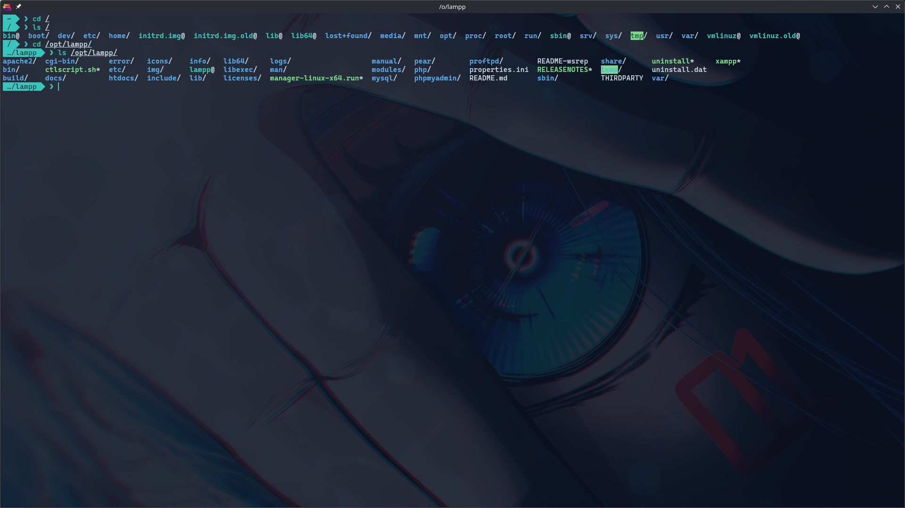

# kitty + fish — Miku theme

A dark, teal-forward terminal setup inspired by Hatsune Miku, for
[kitty](https://sw.kovidgoyal.net/kitty/) and [fish](https://fishshell.com/).

Originally built on Debian 13 with KDE Plasma (KWin/Wayland), but the installer
also supports Arch, Fedora, openSUSE and macOS.

Translucent but still readable, with a matching fastfetch, a powerline-style
prompt and a palette built around Miku's signature teal.




## Features

- **Palette:** deep navy background, teal as the primary color, pink reserved
  for accents and errors.
- **kitty:** 0.88 opacity with KWin blur behind it, teal cursor, powerline tab
  bar, and a minimal config split into behavior (`kitty.conf`) and theme
  (`miku.conf`).
- **fish:** syntax and pager colors, plus a one-line prompt with the short path
  inside an arrow, git branch/state and exit status.
- **fastfetch:** runs once when a terminal opens and matches the terminal
  palette. Nested shells do not repeat it.
- **Safe installer:** backs up only the files it is about to overwrite.

## Requirements

- Linux or macOS with `kitty` and `fish`. The installer detects and supports:
  - `apt` — Debian, Ubuntu, Mint…
  - `pacman` — Arch, Manjaro, EndeavourOS…
  - `dnf` — Fedora, RHEL, Nobara…
  - `zypper` — openSUSE
  - `brew` — macOS / Linuxbrew
- **CaskaydiaCove Nerd Font Mono** — used by kitty and by the prompt icons.
  The installer can download it from Nerd Fonts.
- **fastfetch** — optional. Option 1 uses your existing fastfetch and config if
  you have one; option 2 installs the package and the matching Miku theme.
- **KWin** (or another compositor with blur) for the translucent background
  effect. On non-KDE setups the opacity still works, just without blur.

## Structure

```
kitty/
├── kitty.conf      # font, keybindings, window and tab behavior
└── miku.conf       # palette, opacity, cursor, tab and border colors
fish/
├── config.fish     # startup: fastfetch once per terminal
├── conf.d/
│   └── miku.fish   # syntax and pager colors
└── functions/
    └── fish_prompt.fish
fastfetch/
├── config.jsonc    # palette-matched welcome screen
└── logo.txt        # Miku ASCII logo
install.sh
LICENSE
screenshots/
```

## Installation

```bash
git clone <your-repo-url>
cd kitty-fish-miku
./install.sh
```

If you do not use git, download the repository as a ZIP (**Code →
Download ZIP**), extract it and run `./install.sh` from that folder.

At startup the script asks what to install:

```
What do you want to install?
  1) kitty + fish (keep your own fastfetch, if installed)
  2) kitty + fish + Miku fastfetch theme
```

Option 1 never installs or modifies fastfetch. If you already have fastfetch,
the shell will keep using **your** binary and **your** fastfetch config
(`$XDG_CONFIG_HOME/fastfetch` or `~/.config/fastfetch`) exactly as it is. If you
do not have it, the welcome block is simply skipped.

Option 2 installs the `fastfetch` package if needed and copies the Miku config
and logo, so the welcome screen matches the terminal out of the box.

Non-interactive options:

```bash
./install.sh --yes                    # kitty + fish only
./install.sh --yes --with-fastfetch   # kitty + fish + fastfetch theme
```

The script:

1. Asks for the install mode and detects the distribution/package manager.
2. Checks `kitty`, `fish`, the Nerd Font and (in full mode) `fastfetch`,
   offering to install whatever is missing with the native package manager.
   `fastfetch` is installed automatically in full mode, since that is the mode
   you picked.
3. Backs up the files it will overwrite to
   `$XDG_CONFIG_HOME/<program>/backups/backup_YYYYmmdd_HHMMSS/`
   (`~/.config` when `XDG_CONFIG_HOME` is not set).
4. Copies the theme. Files that are not part of the theme — `fish_variables`,
   `completions`, other kitty or fastfetch configs — are left untouched.
5. Points kitty's `shell` at the fish binary found on this system, so the same
   config works on macOS/Homebrew and NixOS, where fish is not in `/usr/bin`.

After installing, open a new kitty window or press `alt+f5` to reload the kitty
config, and run `exec fish` (or open a new terminal) for fish.

## Palette

| Role | Color |
| --- | --- |
| Background | `#0B1220` |
| Foreground | `#C9D6E3` |
| Primary teal (titles, keys, cursor, prompt) | `#39C5BB` |
| Light teal (URLs, operators) | `#6FE0D6` |
| Pink (user, git, errors) | `#E12885` |
| Muted (secondary text, comments) | `#7A8CA0` |
| Border (inactive) | `#22324A` |
| Yellow (quotes, warnings) | `#F0C674` |
| Blue (redirections) | `#5AA9E6` |

ANSI colors are remapped in `kitty/miku.conf`; fish uses the same hex values in
`fish/conf.d/miku.fish`.

## Customization

- **Opacity:** `background_opacity` in `kitty/miku.conf` (currently `0.88`).
- **Colors:** `kitty/miku.conf` and `fish/conf.d/miku.fish`.
- **Prompt:** `fish/functions/fish_prompt.fish`. It shows `~` in the home
  directory, `~/dir` one level below it, and `…/dir` deeper. The arrow glyph is
  `U+E0B0`, included in Nerd Fonts.
- **Window size:** `initial_window_width` / `initial_window_height` in
  `kitty/kitty.conf`. The defaults (`1280x720`) fit the full fastfetch block
  (130×35 cells) without scrolling.
- **fastfetch:** edit `fastfetch/config.jsonc` and `fastfetch/logo.txt` in this
  repo; the installer copies them in full mode.

## Notes

- kitty cannot blur its own background on Linux; `background_blur` is
  macOS-only. The blur comes from KWin's **Blur** desktop effect
  (System Settings → Desktop Effects → Blur).
- fastfetch is only launched if the command exists, and only in the first
  interactive shell (`FASTFETCH_SHOWN` guards nested shells).
- The installer is idempotent: running it again creates a new timestamped
  backup before copying.
- If the kitty or fish config directories are symlinks managed by a dotfiles
  tool, the installer moves the linked files into the backup directory. Check
  the backup before committing.

## Rollback

Each program keeps its own backups:

```bash
CONFIG="${XDG_CONFIG_HOME:-$HOME/.config}"
ls "$CONFIG/kitty/backups/"
ls "$CONFIG/fish/backups/"
cp -r "$CONFIG/kitty/backups/backup_YYYYmmdd_HHMMSS/." "$CONFIG/kitty/"
cp -r "$CONFIG/fish/backups/backup_YYYYmmdd_HHMMSS/." "$CONFIG/fish/"
```

## License

[MIT](LICENSE) © 2026 1Dragon0

## Disclaimer

Fan-made theme. Hatsune Miku is a character owned by Crypton Future Media.
